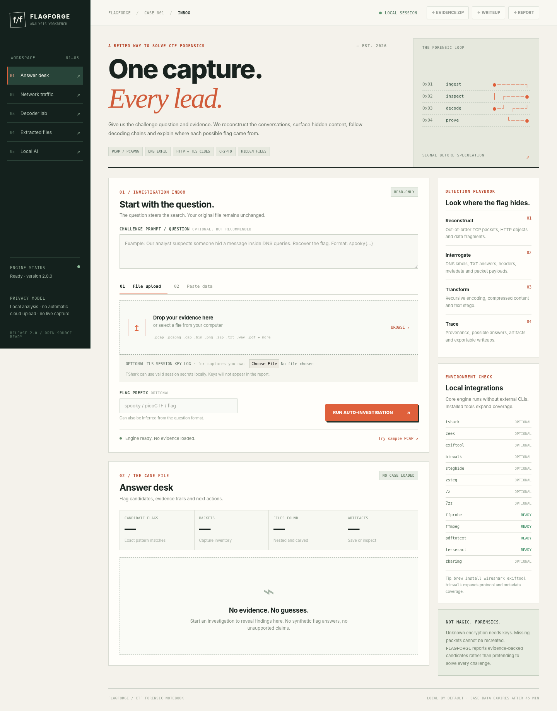

# FLAGFORGE 2.0

**A question-aware CTF evidence workbench — one local website for PCAP/PCAPNG investigations, hidden text, encoding chains, transferred files and potential flag discovery.**



FLAGFORGE is a working Python + FastAPI backend with a purpose-built, responsive HTML/CSS/JavaScript UI. It is **local-first, free, source-available, and runnable with VS Code on macOS or Linux**. It does not automatically transmit your evidence to third-party services.

> **Reality check:** No tool can guarantee the correct flag from **any** unknown PCAP, especially with custom encryption, missing packets, unsupported protocols or challenge-specific reasoning. FLAGFORGE displays **candidate flags with evidence**, not scoreboard-confirmed answers. The scoring heuristic is *not a probability of correctness*. Designed for offline CTF challenge files, not live interception.

## Quick start: macOS / Linux

Prerequisites: **Python 3.10+** and a terminal. For the optional AI feature, install Ollama separately. No paid API key is required for the core analyzer.

```bash
unzip FlagForge-v2.zip
cd FlagForge
chmod +x run.sh
./run.sh
```

Open **http://127.0.0.1:8787**. `run.sh` creates `.venv` and installs Python dependencies, then starts a localhost-only server. End with `Ctrl+C`.

In VS Code: `File → Open Folder →


FlagForge`, then open the integrated terminal and run `./run.sh`.

### Test immediately

1. Click **Try sample PCAP** (or drag `examples/demo-capture.pcap` onto the drop area).
2. Paste a question such as `Find the flag transmitted over TCP.`
3. Click **RUN AUTO-INVESTIGATION**.
4. Read the ranked candidate, its evidence source and decode chain. Explore **Network traffic** and **Recovered files**. Export JSON or a Markdown writeup.
5. To test other file families, load `examples/demo-encoding.txt`, `examples/demo-image.png` and `examples/demo-archive.zip`.

## What makes 2.0 different?

Rather than simply replicating Wireshark or CyberChef, it builds a **case-solving sequence**:

**Challenge question → bounded network reconstruction → CTF heuristics → recursive decoding/carving → source-backed candidates → recommended next passes → report/writeup.**

The question changes which investigation steps are prioritized and can supply the expected flag prefix (e.g. `spooky{...}`). It does not change the bytes analyzed. Candidate ranking uses source quality, direct/decoded detection, multiple sightings and whether the source matches the challenge topic. **Candidate score ≠ scoreboard confirmation.**

## Capability matrix

| Evidence type | Built-in workflow | Optional enhancement / limitation |
|---|---|---|
| PCAP, PCAPNG | Magic-byte detection, Ethernet, VLAN, Linux cooked, raw IPv4/IPv6, bounded TCP reassembly, conversations, packet ledger, stream exports, HTTP/1.x headers and bodies, UDP/ICMP payloads | Complex IP fragmentation, IPv6 extension chains, overlapping TCP ambiguity may need Wireshark/TShark |
| DNS | QNAME, TXT, label concatenation, numeric sequence ordering, multi-answer TXT joining, scans of assembled encoded messages | DNS-over-HTTPS remains encrypted absent TLS keys; TCP DNS is not fully decoded natively |
| Covert network clues | Reassemble per-direction ICMP echo data; examine printable IPv4 ID low-byte sequences | Heuristic, not universal IPID/timing-stego detection |
| HTTP | Chunked transfer parsing, optional gzip/deflate decompression, body/file extraction, header and URL flag scanning | HTTP/2 and HTTP/3 need external dissectors; HTTP framing is bounded/best-effort |
| TLS | Recover unencrypted TLS SNI hostnames; optional NSS `SSLKEYLOGFILE` with TShark | No decryption without valid session keys and compatible protocol/capture |
| USB HID | Boot-keyboard report replay with shift and backspace handling | **Needs TShark**; US layout assumption; other USB devices may not work |
| Transferred objects | Conservative carving of ZIP/PNG/JPEG/PDF/GZIP/GIF inside TCP payloads; nested file recursion | **TShark** can additionally export supported HTTP, SMB, TFTP, IMF and FTP-DATA objects |
| Zeek | Reads bounded JSON logs and scans them as additional evidence | **Needs Zeek** installed locally |
| Text / encodings | Base64, Base32, Base85, ASCII85, hex, binary, decimal bytes, URL/HTML/unicode escapes, ROT13, Atbash, Caesar, reverse, Morse, bounded single-byte XOR, GZIP/zlib; dedicated decoder lab | Not general-purpose cryptanalysis; custom cipher challenges may need a custom algorithm |
| Capture metadata | Binary strings, ASCII/UTF-16LE/BE flag recovery, PCAPNG comments and encoded metadata-string exploration | Not every arbitrary format is semantically decoded |
| Images | PNG/JPEG/GIF/BMP, limited RGB/RGBA LSB checks, embedded ZIP, image trailer, metadata | Optional `exiftool`, `zsteg`, `tesseract`, `zbarimg`, `binwalk` |
| Archives | ZIP/TAR/GZIP, bounded nested inspection, known-password ZIP unlock | Not password cracking; optional steghide passphrase extraction for carriers |
| Audio / PDF | WAV PCM bitplanes, PDF page text; optional MP3 conversion | Optional FFmpeg, external OCR; visual/audio puzzles may require manual interpretation |
| AI reasoning | Ask free **local Ollama** model to interpret evidence and suggest next actions within same dashboard | Model must be installed and running; AI suggestions remain unverified hypotheses |
| Reports | Evidence provenance, SHA-256, artifacts, JSON and Markdown writeup | Nothing is automatically submitted to a CTF scoreboard |

**Current bounds:** 35 MB uploads, 30,000 parsed packets, 750 KB per TCP stream, bounded decoder breadth/depth, bounded nested archive extraction, maximum 60 artifacts, 45-minute job access TTL. These limits deliberately prioritize responsiveness and protection from malformed inputs rather than claiming unbounded PCAP support.

### Optional free local tools (macOS)

These integrate automatically when present in your `PATH`. Only install the ones you want:

```bash
brew install wireshark zeek exiftool binwalk ffmpeg tesseract zbar
```

- `wireshark` formula supplies **TShark**, the CLI used by this app; GUI Wireshark is not required.
- `zeek` supplies offline protocol logs.
- `exiftool` extracts metadata; `binwalk` identifies embedded signatures; `ffmpeg`/`ffprobe` help with audio; `tesseract` and `zbarimg` recover image text/QR codes.
- `steghide` and `zsteg` are separate optional installs and may be platform-dependent. The UI only enables their relevant behavior if the executables are available.

Verify via the tool-availability section in the sidebar. **Core analysis runs without any of them.**

### Optional free local AI

Download Ollama from https://ollama.com/download, then run:

```bash
ollama pull qwen2.5-coder:3b
ollama serve
```

If Ollama is already running, do not launch a duplicate server. In the **Local AI** tab, choose `qwen2.5-coder:3b` and ask a question about the evidence. The backend connects only to `http://127.0.0.1:11434/api/generate`; it submits a bounded, sanitized report excerpt. The content of that excerpt may contain evidence (including candidate flags), so inspect it before relying on the local model. It does not receive the original file or a TLS key log. You can replace the model string with another installed local Ollama model.

**AI is optional.** Normal evidence extraction and auto-investigation are deterministic and require no AI model, Claude, GPT or Codex.

## API at a glance

| Method / route | Purpose |
|---|---|
| `GET /` | Local web UI |
| `GET /api/health` | Version, installed helper tools |
| `POST /api/analyze` | Multipart `file` or `text`, optional `question`, `prefix`, `tls_keylog` |
| `POST /api/decode` | `{ "text": "...", "prefix": "flag" }` standalone decoding |
| `POST /api/ai` | Local Ollama evidence explanation by `job_id` |
| `POST /api/unlock-zip` | Known-password ZIP extraction |
| `POST /api/steghide` | Known-passphrase steghide extraction where installed |
| `GET /api/sample/pcap` | Built-in synthetic PCAP |
| `GET /api/report/{job_id}` | JSON report |
| `GET /api/writeup/{job_id}` | Markdown report |
| `GET /api/bundle/{job_id}` | Case report + up to 24 MiB of recovered artifacts in a ZIP |
| `GET /api/artifact/{job_id}/{artifact_id}` | Recovered bytes |

### Development / tests

```bash
python3 -m venv .venv
source .venv/bin/activate
python -m pip install -r requirements.txt -r requirements-dev.txt
python -m pytest -q
python -m uvicorn app.main:app --host 127.0.0.1 --port 8787
```

The included synthetic regressions cover text, decoding, split TCP, PCAPNG, DNS TXT, DNS exfil reconstruction, HTTP gzip/chunked transfer, ZIP extraction, PNG LSB, UTF-16, ICMP reconstruction, embedded stream ZIP, source metadata and API guards. Optional helper binaries are **not available in every CI/host**, so optional workflows are documented but not claimed end-to-end tested on a Mac.

## Security & deployments

- Localhost only. **Do not expose the app as an unauthenticated public upload server.** Parsing hostile files/metadata and invoking external dissectors is risky.
- Uploads and artifacts are held in **in-memory case jobs** (up to 8 entries); source files used by optional CLIs are written to temporary directories. Case access expires after 45 minutes and is cleaned on subsequent requests.
- No live packet capture, no arbitrary shell commands, no browser telemetry and no automatic cloud model calls.
- Uploaded TLS session key logs are used only with TShark when installed; not included in reports. Key files are created only in temporary directories and are overwritten with empty bytes before removal on normal cleanup. This is not a secure-erasure guarantee.
- If you later build a public hosted version, use authenticated accounts, per-upload isolated containers, strict process/time/memory limits, malware scanning, rate limiting, asynchronous job queues and object storage. **Vercel static deployment alone is insufficient** because packet processing uses Python and optional native binaries.

More details: [Security](SECURITY.md), [research and comparisons](docs/research.md), [coverage and limits](docs/coverage.md).

**License:** MIT. Built for CTF learning, benign forensic analysis and authorized captures.
